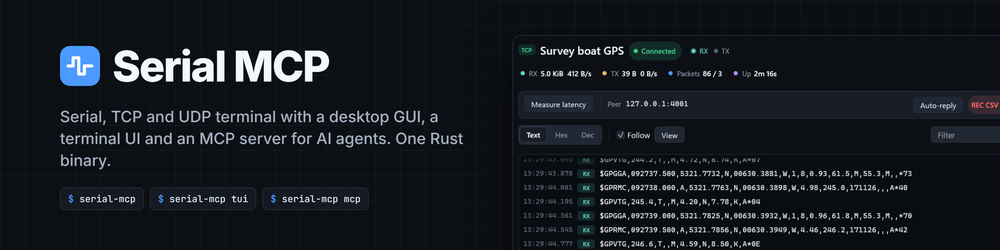
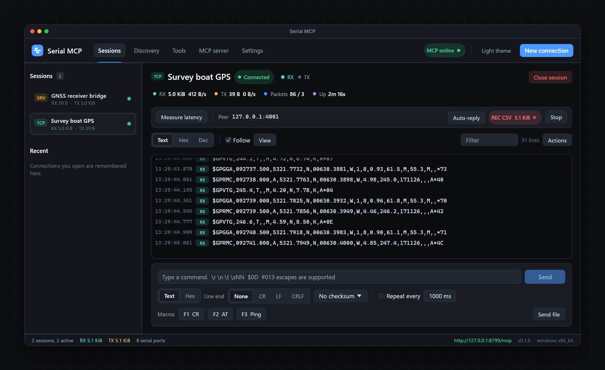
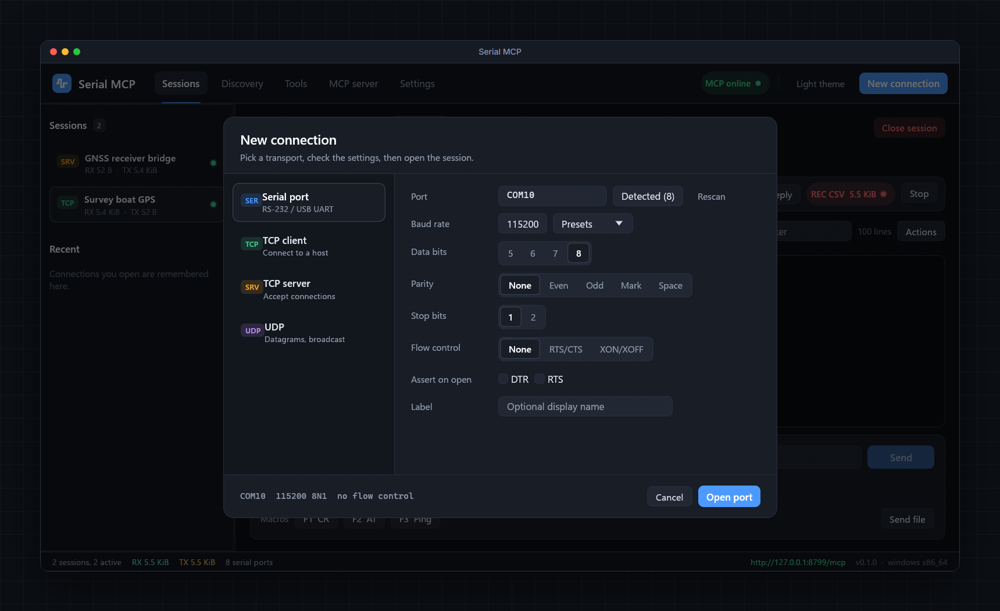
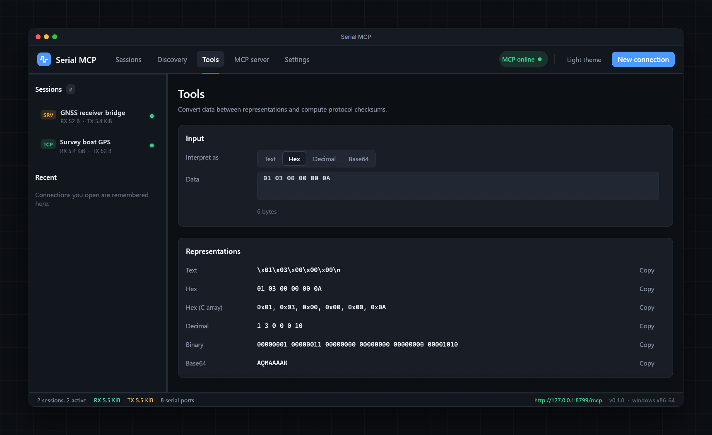
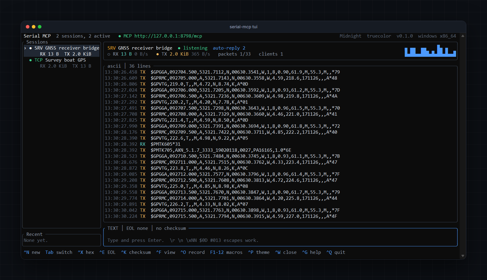

Serial MCP is a serial, TCP and UDP terminal for people who work with devices: PLCs, GPS receivers, modems, sensors, embedded boards. It ships as one Rust binary with a desktop GUI, a terminal UI and a Model Context Protocol server, so you and an AI agent can work on the same port at the same time.

[](https://github.com/anand34577/serial-mcp/actions/workflows/ci.yml)
[](LICENSE)



## Why

Hercules SETUP has been a favourite bench terminal for years, but it's a Windows-only desktop program. Serial MCP keeps the same idea (pick a port, see every byte, send anything) and runs on Windows, macOS and Linux, including ARM boards and SSH sessions. The MCP server means an agent can open a port, send a Modbus request with the right CRC, and read the reply without you copying hex back and forth.

```
serial-mcp            desktop GUI (falls back to the TUI when there is no display)
serial-mcp tui        terminal UI: SSH, Raspberry Pi, headless servers, mouse and touch
serial-mcp mcp        MCP server over stdio or HTTP for Claude, Cursor and other agents
serial-mcp serial …   scriptable one-shot and interactive terminals
```

All front ends share one engine. A port opened in the GUI or TUI is usable by an agent over MCP, and sessions an agent opens appear in the GUI and TUI.

## Features

| Area | What you get |
| --- | --- |
| **Serial** | Port list with USB VID:PID and product, 50 to 4,000,000 baud, 5 to 8 data bits, none/even/odd parity, 1/2 stop bits, RTS/CTS and XON/XOFF, DTR/RTS outputs, live CTS/DSR/RI/CD inputs, break |
| **TCP client** | Connect timeout, auto-reconnect, Telnet/NVT negotiation, latency probe |
| **TCP server** | Any interface/port, up to 512 clients, per-client status, broadcast writes, echo |
| **UDP** | Local bind, default target, broadcast, echo, replies to the last sender |
| **Discovery** | UDP broadcast probe with custom payload; lists responders with RTT; one click opens a UDP session to a device |
| **Terminal** | Text / hex dump / decimal views, per-line timestamps and RX/TX tags, filter, follow, wrap, copy, save, 20,000-line view over a 1 MiB ring buffer |
| **Sending** | Hercules-style escapes (`\r \n \t \xNN $0D \#013 $$`), hex mode, CR/LF/CRLF, live byte preview, history, repeat every *n* ms, send file (16 MiB), drag and drop |
| **Checksums** | CRC-16 Modbus / CCITT / XMODEM, CRC-32, LRC, XOR, SUM-8, appended automatically on send |
| **Macros** | 12 macros on F1 to F12, editable in Settings, shared with the TUI and MCP |
| **Recording** | Text log, CSV (`timestamp,direction,length,hex,text`) or raw received bytes; flushed as data arrives |
| **Auto-reply** | Pattern → reply rules per session (text or hex), matched across chunk boundaries, with hit counters: simulate devices, answer keep-alives, ACK frames |
| **Tools** | Data converter (text, hex, C array, decimal, binary, Base64) and checksum calculator |
| **MCP** | 24 tools, live resources, 2 prompts, stdio and HTTP transports |
| **Validation** | Every form field is checked before anything opens: host names, IPs, port ranges, port conflicts, baud limits, hex/escape syntax, broadcast rules, file paths |

## Desktop GUI

| New connection | Tools |
| --- | --- |
|  |  |

- **New connection** (Ctrl+N) opens a dialog with a transport picker and a validated form. Errors appear under the field and the Open button stays disabled until the form is valid. Failed opens reopen the dialog with your settings.
- **Recent** connections are remembered and reopen pre-filled.
- Each session shows status, live RX/TX activity lights, throughput sparklines, packet counters, uptime or client count, and modem lines for serial ports.
- **Record** and **Auto-reply** sit on the session bar; the REC indicator pulses while recording.
- The layout adapts from 1040×700 up: short windows fold the metric tiles into one line, narrow ones move view options into menus.
- Dark and light themes, the system UI font (Segoe UI, SF, Inter/Noto/DejaVu) and monospace font (Cascadia, Menlo, JetBrains Mono/DejaVu Mono).

Shortcuts: Ctrl+N new connection, Enter send, Up/Down history, F1 to F12 macros, Ctrl+F filter, Ctrl+L clear, Ctrl+Tab next session, Ctrl+W close session.

## Terminal UI



```bash
serial-mcp tui                          # detect colours and glyphs
serial-mcp tui --mcp 127.0.0.1:8765     # let agents share the TUI's sessions
serial-mcp tui --theme Arctic           # Midnight, Arctic, Ember, Light, "High contrast"
serial-mcp tui --colors 16 --ascii      # old consoles, serial terminals, Linux VT
```

- **Any terminal:** truecolor, 256-colour, 16-colour and monochrome (`NO_COLOR`) are detected and every theme is adapted to them. Linux VT and non-UTF-8 locales get ASCII borders and glyphs. Override with `--colors`, `--ascii`, `SERIAL_MCP_COLORS` or `SERIAL_MCP_GLYPHS`.
- **Mouse and touch:** tap sessions, recent connections, dialog fields, choices and buttons, and the shortcut hints in the footer; scroll or swipe the terminal and lists. This works in Windows Terminal, iTerm2, GNOME Terminal, Kitty, tmux, and Termux / JuiceSSH / Blink on phones. Hold Shift while dragging to select text.
- **Animations:** RX/TX activity lights, a live throughput sparkline, a spinner while connecting, and a blinking REC indicator.
- Validated New connection form (Ctrl+N), recording (Ctrl+O), hex input (Ctrl+X), line endings (Ctrl+E), checksums (Ctrl+K), views (Ctrl+F), themes (Ctrl+P), RTS/DTR (Ctrl+R / Ctrl+D), macros (F1 to F12), send file (Ctrl+S), help (Ctrl+G).

## Headless CLI

```bash
serial-mcp ports
serial-mcp serial COM3 --baud 115200 --send "AT\r" --read-ms 1000
serial-mcp serial /dev/ttyUSB0 --baud 9600 --interactive
serial-mcp tcp-client 192.168.1.50 23 --nvt --interactive
serial-mcp tcp-server 9000 --echo
serial-mcp udp --local-port 4000 --remote 192.168.1.50:4000 --send "PING\r\n"
serial-mcp scan --port 4000 --payload-hex 00 --timeout-ms 1500
serial-mcp tcp-probe 192.168.1.50 23
serial-mcp udp-listen 4000 --timeout-ms 5000
serial-mcp checksum "01 03 00 00 00 0A" --hex --algorithm crc16_modbus
serial-mcp config        # config path and a ready-to-paste MCP client snippet
```

Interactive commands: `/help`, `/hex on|off`, `/format ascii|hex|dec`, `/eol none|cr|lf|crlf`, `/rts on|off`, `/dtr on|off`, `/break on|off`, `/log PATH`, `/quit`.

## MCP server

```bash
serial-mcp mcp --transport stdio
serial-mcp mcp --transport http --bind 127.0.0.1:8765     # POST /mcp, GET /health
claude mcp add serial-mcp -- /path/to/serial-mcp mcp --transport stdio
```

Claude Desktop / Cursor:

```json
{
  "mcpServers": {
    "serial-mcp": { "command": "C:\\path\\to\\serial-mcp.exe", "args": ["mcp", "--transport", "stdio"] }
  }
}
```

The GUI's **MCP server** page starts the HTTP endpoint inside the app (optionally at launch) and copies these snippets with the correct path.

| Tool | Purpose |
| --- | --- |
| `list_serial_ports` | Ports with USB metadata |
| `open_serial`, `open_tcp_client`, `open_tcp_server`, `open_udp` | Open sessions |
| `list_sessions`, `get_session`, `close_session` | Inspect and close |
| `write_session` | Send text, hex or Base64, with optional line ending and checksum |
| `read_session`, `wait_for_data` | Read with a sequence cursor, or wait for a pattern |
| `set_control_lines` | RTS, DTR, break, echo |
| `set_logging` | Record to text, CSV or raw |
| `set_auto_responses`, `get_auto_responses` | Device simulation rules and hit counts |
| `compute_checksum` | CRC-16/32, LRC, XOR, SUM-8 |
| `clear_session_log`, `send_file`, `list_macros`, `run_macro` | Utilities |
| `udp_scan`, `udp_listen`, `tcp_probe` | Network discovery |
| `get_server_info` | Version, platform, uptime |

Resources: `serial-mcp://info`, `serial-mcp://ports`, `serial-mcp://sessions`, `serial-mcp://sessions/{id}/status`, `serial-mcp://sessions/{id}/log`. Prompts: `diagnose_serial_link`, `echo_test`. See [docs/MCP.md](docs/MCP.md) for request examples.

The HTTP transport has **no authentication**. It binds to localhost by default and the GUI warns when you choose another address.

## Documentation

The [wiki](https://github.com/anand34577/serial-mcp/wiki) covers installation per OS, a first-session walkthrough, every setting, recording and auto-reply, MCP setup for different clients, and troubleshooting. Its source lives in [`docs/wiki/`](docs/wiki/).

## Install and build

```bash
cargo build --release              # GUI + TUI + MCP + CLI in target/release/serial-mcp
cargo install --path crates/cli --locked
```

Build variants (one binary each):

| Command | Contents | Use for |
| --- | --- | --- |
| `cargo build --release` | GUI, TUI, MCP, CLI | Desktops |
| `cargo build --release --no-default-features --features tui,udev` | TUI, MCP, CLI | Servers, Raspberry Pi, ARM boards |
| `cargo build --release --no-default-features --features tui` | Same, no libudev | Static musl builds, minimal images |

Linux build packages: `build-essential pkg-config libudev-dev`, plus `libxkbcommon-dev libwayland-dev libx11-dev libxi-dev libgl1-mesa-dev` for the GUI. At run time the GUI loads X11/Wayland/OpenGL dynamically, so the same binary still runs the TUI, MCP and CLI on machines without a display.

### Cross-compiling

```bash
cargo install cross --git https://github.com/cross-rs/cross
cross build --release --target aarch64-unknown-linux-gnu --no-default-features --features tui,udev
cross build --release --target armv7-unknown-linux-gnueabihf --no-default-features --features tui,udev
rustup target add aarch64-pc-windows-msvc && cargo build --release --target aarch64-pc-windows-msvc
rustup target add aarch64-apple-darwin x86_64-apple-darwin
cargo build --release --target aarch64-apple-darwin
```

Tagged pushes (`v*`) build all of these in GitHub Actions ([release.yml](.github/workflows/release.yml)).

| OS | Architectures | GUI | TUI / MCP / CLI |
| --- | --- | --- | --- |
| Windows 10/11 | x86_64, ARM64 | ✅ | ✅ |
| macOS 11+ | Intel, Apple Silicon | ✅ | ✅ |
| Linux | x86_64 | ✅ | ✅ (glibc and static musl) |
| Linux | aarch64, armv7 | build from source | ✅ |

## Configuration

`%APPDATA%\serial-mcp\config.toml` on Windows, `~/Library/Application Support/serial-mcp/config.toml` on macOS, `~/.config/serial-mcp/config.toml` on Linux. Override with `--config FILE` or `SERIAL_MCP_CONFIG`. It stores theme, TUI theme, timestamps, buffer size, log folder, macros, MCP bind/autostart and recent connections. Saves are atomic; out-of-range values are clamped on load.

## Architecture

| Crate | Responsibility |
| --- | --- |
| `crates/core` | Transports, session manager, ring buffer, codecs, NVT, checksums, auto-responder, recording, validation, view model, config |
| `crates/mcp` | JSON-RPC/MCP protocol, tools, resources, prompts, stdio and HTTP transports |
| `crates/gui` | egui/eframe desktop app |
| `crates/tui` | ratatui/crossterm terminal app |
| `crates/cli` | The `serial-mcp` binary: picks GUI or TUI, runs MCP and headless commands |

## Tests

```bash
cargo test --workspace
cargo clippy --workspace --all-targets -- -D warnings
```

The tests cover codecs, checksums against standard check values, the auto-responder (including cross-chunk matching), every recording format, validation rules, config round-trips, TCP/UDP loopback transports, MCP protocol conformance and tools, and a full TUI keyboard and mouse flow rendered off-screen.

## Limitations

- HW group's proprietary UDP Config and TEA authorization are not implemented; discovery sends a configurable probe and shows raw replies.
- Mark/space parity is offered by the configuration format for compatibility but rejected by the serial backend; use none, even or odd.
- RFC 2217 (serial over Telnet) is not implemented; Telnet support is a plain NVT terminal.
- The HTTP MCP transport is unauthenticated.

## Contributing

See [CONTRIBUTING.md](CONTRIBUTING.md). Security reports go through [SECURITY.md](SECURITY.md).

## License

MIT. See [LICENSE](LICENSE). Hercules SETUP is a product of HW group s.r.o.; this is an independent implementation and is not affiliated with HW group.
