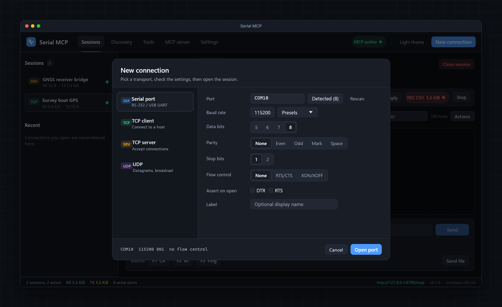
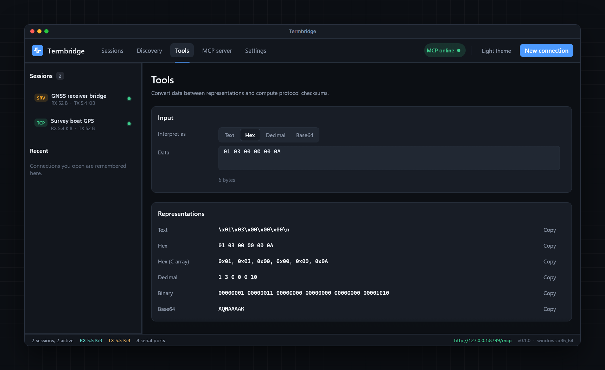

# Desktop app

The desktop app has five pages along the top: **Sessions**, **Discovery**, **Tools**, **MCP server** and **Settings**. The sidebar on the left always lists open sessions and recent connections, and the bar at the bottom shows totals and the MCP endpoint.

## Opening connections

**New connection** (top right, or Ctrl+N) opens a dialog with the four transports on the left and the settings on the right.

| Transport | Use it for | Key settings |
| --- | --- | --- |
| Serial port | USB-serial adapters, RS-232/485 converters, dev boards | Port, baud rate, data bits, parity, stop bits, flow control, DTR/RTS on open |
| TCP client | Serial device servers (Moxa, Lantronix), PLC gateways, Telnet consoles | Host, port, timeout, Telnet negotiation, auto-reconnect |
| TCP server | Letting a device or script connect to you; simulating a device | Bind address, port, max clients, echo |
| UDP | Datagram protocols, broadcast discovery, IoT sensors | Bind address, local port, remote host and port, broadcast, echo |

Shortcuts in the dialog: **Telnet**, **Modbus**, **4001**, **8080** fill common TCP ports; **All** and **Local only** fill `0.0.0.0` and `127.0.0.1`. **Ctrl+Enter** opens.

If opening fails (the port is busy, the host refuses), the error appears as a notification and the dialog reopens with your settings so you can fix them.

**Recent** in the sidebar remembers the last eight connections. Click one to reopen the dialog pre-filled; right-click → **Forget** to remove it.

## The session screen

From top to bottom:

- **Header**: transport badge, name, status (Connected, Listening, Bound, Connecting with a spinner, Error) and **RX/TX lights** that flash whenever data moves.
- **Metrics**: bytes received and sent with live rates and a sparkline, packet counts, and uptime (or the client count for TCP servers). On short windows these fold into one line under the title.
- **Control bar**: depends on the transport.
  - Serial: **RTS**, **DTR** and **Break** toggles, and **CTS**, **DSR**, **RI**, **CD** lights for the device's handshake lines.
  - TCP server: **Echo** and a chip per connected client.
  - UDP: **Echo** and the last peer address.
  - TCP client: **Measure latency** and the peer address.
  - On the right: **Auto-reply** and **Record** (see [Recording and Auto-Reply](Recording-and-Auto-Reply)).
- **Toolbar**: Text / Hex / Dec view, Follow (stay at the newest line), Time, Wrap, which directions to show, a line filter, and Copy / Save / Clear.
- **Terminal**: one line per message, with timestamp, a direction tag (RX, TX, SYS for events, ERR for errors, IAC for Telnet negotiation) and the data.
- **Composer**: the send box, Text/Hex mode, line ending, checksum, repeat, macros and Send file.

## Sending data

| You want to | Do this |
| --- | --- |
| Send a line | Type and press Enter |
| Reuse a previous command | Up / Down in the send box |
| Send raw bytes | Switch to **Hex** and type `01 03 00 00 00 0A` (spaces, commas and `0x` are all fine) |
| Add a CRC or other checksum | Pick it in the checksum list. It's appended before the line ending. |
| Poll a device | Tick **Repeat every** and set the interval (10 ms to 1 hour) |
| Send a firmware image or script | **Send file**, or drop the file on the window and then confirm in **Send file** (up to 16 MiB) |
| Send a saved command | Click a macro or press F1 to F12 |

Escapes in text mode: `\r` `\n` `\t` `\0` `\\`, `\xNN` for any byte, `$NN` (hex) and `\#NNN` (decimal), and `$$`, `##`, `<<` for a literal `$`, `#` or `<`.

The grey text on the right of the composer previews the exact bytes before you send. If the input can't be parsed, it turns red and says why.

## Discovery

Sends one UDP datagram to a broadcast or unicast address and lists every reply with its round-trip time and payload. Many embedded devices answer a vendor-specific probe; put its bytes in **Payload (hex)**. **Open UDP session** on a result opens the New connection dialog aimed at that device.

## Tools

- **Representations** converts between text with escapes, hex, a C array, decimal, binary and Base64. Type in any of four input formats.
- **Checksums** shows CRC-16 Modbus, CRC-16 CCITT, CRC-16 XMODEM, CRC-32, LRC, XOR and SUM-8 for the input, plus the full frame with a Modbus CRC.

## Keyboard shortcuts

| Keys | Action |
| --- | --- |
| Ctrl+N | New connection |
| Enter | Send |
| Up / Down | Send history |
| F1 to F12 | Macros |
| Ctrl+F | Focus the line filter |
| Ctrl+L | Clear the terminal |
| Ctrl+Tab / Ctrl+Shift+Tab | Next / previous session |
| Ctrl+W | Close session (asks first) |

On macOS use Cmd instead of Ctrl for N, F, L, W and Enter.
